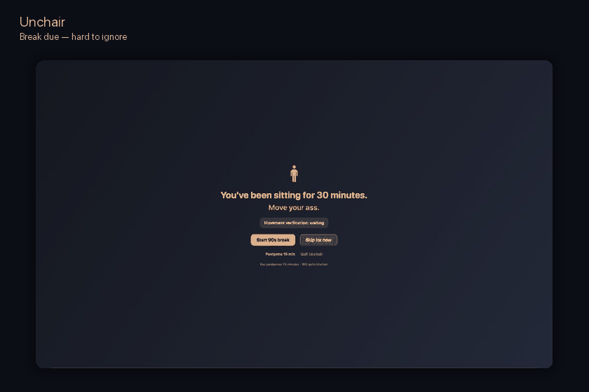
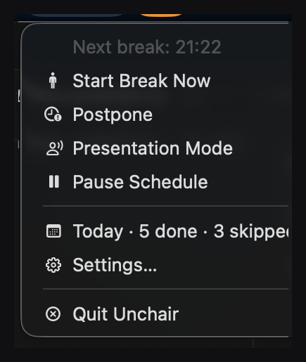
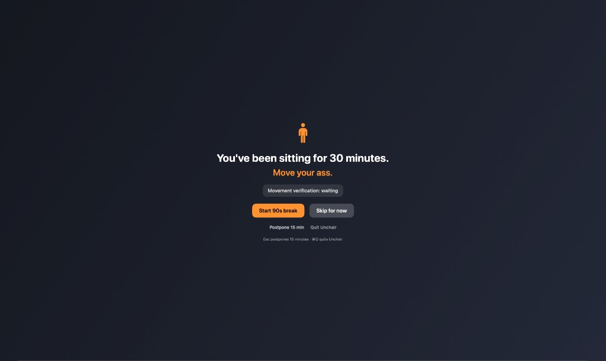
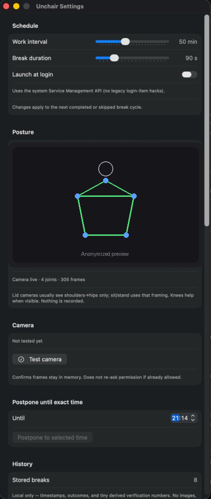
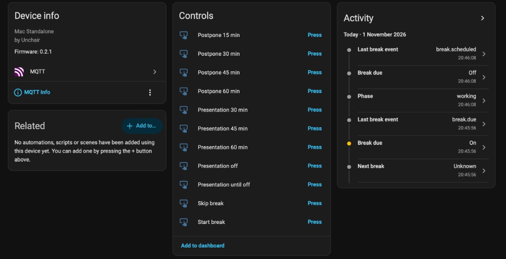

# Unchair

<p align="center">
  <strong>Your Mac knows you've been sitting for 52 minutes.<br/>It would now like evidence that you actually stood up.</strong>
</p>

<p align="center">
  A local-first macOS break app that can use Apple Vision to verify movement — entirely on-device.
</p>

<p align="center">
  <a href="https://github.com/EtienneDeneuve/unchair/actions/workflows/ci.yml"></a>
  <a href="https://github.com/EtienneDeneuve/unchair/releases/latest"></a>
  
  <a href="./LICENSE"></a>
</p>

<p align="center">
  
</p>

A notification can be ignored.

A reminder can be dismissed.

Unchair can wait for you to **stand up and move**.

No account. No backend. No wellness dashboard pretending to be medicine.

## Install

Download the latest signed and notarized build:

**[Download Unchair for macOS](https://github.com/EtienneDeneuve/unchair/releases/latest)**

Then drag **Unchair** into **Applications**.

Requires **macOS 14+**.

Direct releases are Developer ID signed, notarized and stapled. A zip build is also published for Sparkle updates and automation.

## Why this exists

Most break apps ask whether you moved.

Unchair can check.

```text
break due
   |
   v
start break
   |
   v
local camera frame
   |
   v
Apple Vision body pose
   |
   v
sit -> stand + movement evidence
   |
   v
break completed
```

The camera is treated as an ephemeral sensor, not a recording device.

Frames are processed in memory, locally, and discarded. No video, image or body-landmark stream is persisted or uploaded.

If movement verification is unavailable, Unchair fails open rather than trapping you in an impossible break.

Read the actual privacy contract in [docs/PRIVACY.md](./docs/PRIVACY.md).

## What ships today

- native macOS menu-bar app
- configurable sitting / break schedule
- hard-to-ignore break overlay
- local sit → stand detection with Apple Vision
- movement verification
- movement debt: postponing is not completing
- presentation / call safety guard
- local history and Today stats
- launch at login
- signed + notarized direct releases
- Sparkle updates
- optional Home Assistant / MQTT integration
- optional local OpenMetrics / Prometheus endpoint
- optional break-lifecycle OpenTelemetry tracing
- Grafana **Human Runtime** dashboard example
- `unchair` CLI and `unchair doctor`

The Mac-only experience is the complete product. Home Assistant, MQTT, metrics and future Apple companions are optional layers.

## Movement debt

Unchair keeps one intentionally annoying rule:

```text
completed               -> debt cleared
postponed               -> debt preserved
deferredForPresentation -> debt preserved
skipped                 -> explicit non-completion
```

“Remind me later” is not exercise.

## Presentation-safe

Unchair should be annoying.

It should not be career-limiting.

Breaks are deferred when strong presentation signals are present, including camera/microphone use by another app, lock/sleep state, explicit Presentation Mode, and corroborated meeting activity.

While blocked:

- no break overlay
- no camera activation
- no interruption audio
- movement debt stays pending

When the signal clears, the break comes back.

## Home Assistant, because apparently this needed infrastructure

Unchair works completely offline.

If you already run Home Assistant, optional MQTT discovery exposes derived state such as:

- current phase
- sitting duration
- completed / postponed / skipped breaks
- movement minutes
- next break
- presentation mode
- break due

Home Assistant may send a narrow set of commands:

```text
start_break
postpone
skip
presentation_on
presentation_off
```

It cannot fake movement verification or remotely complete a break.

Setup: [docs/home-assistant.md](./docs/home-assistant.md)  
MQTT contract: [docs/mqtt-contract.md](./docs/mqtt-contract.md)

## Human Reliability Engineering

The original requirement was “remind me to stand up”.

Restraint was lost shortly afterwards.

Already shipped:

- Movement Debt
- OpenMetrics
- OpenTelemetry tracing
- Grafana Human Runtime
- CLI diagnostics

Next experiments include:

- Sitting SLO
- Human Error Budget
- Mean Time To Butt-off
- automatic sitting incident reports
- optional Apple Watch / HealthKit evidence
- optional standing-desk and chair sensors

Potential incident:

```text
INCIDENT #CHAIR-2026-11-01

Severity: SEV-2 Glute Availability Degradation
Duration: 2h17
Corrective action: human stood up
```

The terminology is questionable.

The architecture is not.

See [ROADMAP.md](./ROADMAP.md).

## Architecture

```text
                         +------------------+
                         |        UI        |
                         +--------+---------+
                                  |
                                  v
+-------------------+    +--------+--------+    +------------------+
| PresentationGuard |--->|   BreakEngine   |--->| Local history    |
+-------------------+    | + state machine |    +------------------+
                         +--------+--------+
                                  |
                                  v
                         +--------+--------+
                         | Domain events   |
                         +---+---------+---+
                             |         |
                             v         v
                        Evidence    Optional adapters
                        Engine      MQTT / Metrics / OTel
```

Core behavior does not depend on the network, Home Assistant, metrics, tracing or future Apple companions.

### Stack

- Swift + SwiftUI
- AVFoundation
- Apple Vision
- SMAppService
- macOS Keychain
- Network.framework
- XCTest
- Sparkle 2 for direct-channel updates

## Screenshots

| Menu bar | Break overlay |
| :---: | :---: |
|  |  |

| Schedule + local Vision | Home Assistant |
| :---: | :---: |
|  |  |

Documentation assets use synthetic or anonymized camera content where needed.

## Privacy

Privacy is an architecture constraint.

Unchair is not:

- a medical device
- a posture diagnostic tool
- an employee-surveillance product
- a cloud SaaS dependency

Raw camera frames:

- exist only in memory
- are processed locally
- are never persisted
- are never transmitted

Optional integrations receive only explicitly allowed derived state.

Threat model and data flow: [docs/PRIVACY.md](./docs/PRIVACY.md).

## Build from source

```bash
git clone https://github.com/EtienneDeneuve/unchair.git
cd unchair
open Unchair.xcodeproj
```

Run tests:

```bash
xcodebuild test \
  -scheme Unchair \
  -destination 'platform=macOS'
```

Signed/notarized releases are produced with [scripts/release.sh](./scripts/release.sh).

Distribution details: [docs/DISTRIBUTION.md](./docs/DISTRIBUTION.md).  
Release process: [docs/RELEASE.md](./docs/RELEASE.md).

## Contributing

Unchair is spec-driven and test-first.

```text
issue/spec
   -> failing test
   -> minimal implementation
   -> refactor
   -> full test suite
```

Read [CONTRIBUTING.md](./CONTRIBUTING.md) and [agent.md](./agent.md).

The engineering rule is simple:

> If two designs satisfy the specification, choose the one that is easier to delete.

## Status

Unchair is young, usable and moving quickly.

The Mac standalone loop and the optional integration layer are shipping. Apple Watch / HealthKit evidence and the more irresponsible Human Reliability Engineering ideas are tracked in the roadmap.

If Unchair made you stand up before finishing this README, the bug is working.

If you like the idea, **star the repo**. It helps other sedentary developers discover it.

## License

MIT.
