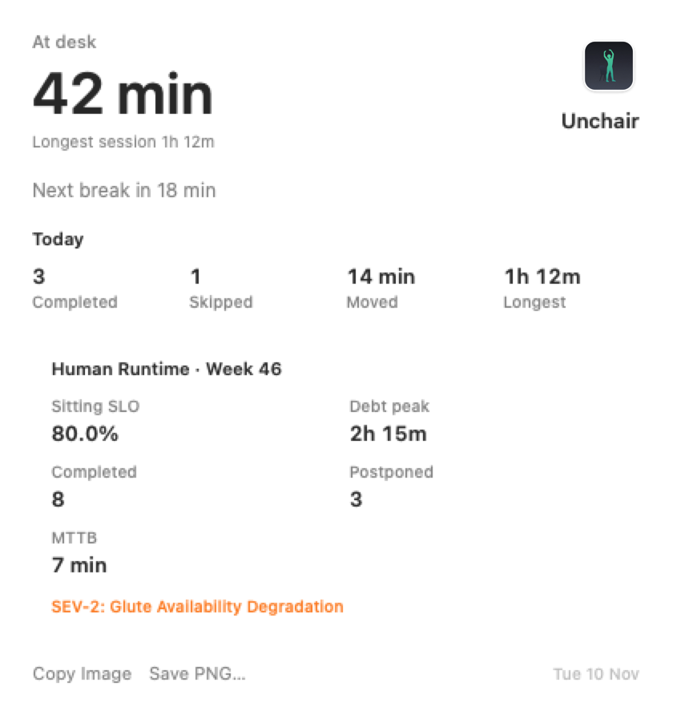
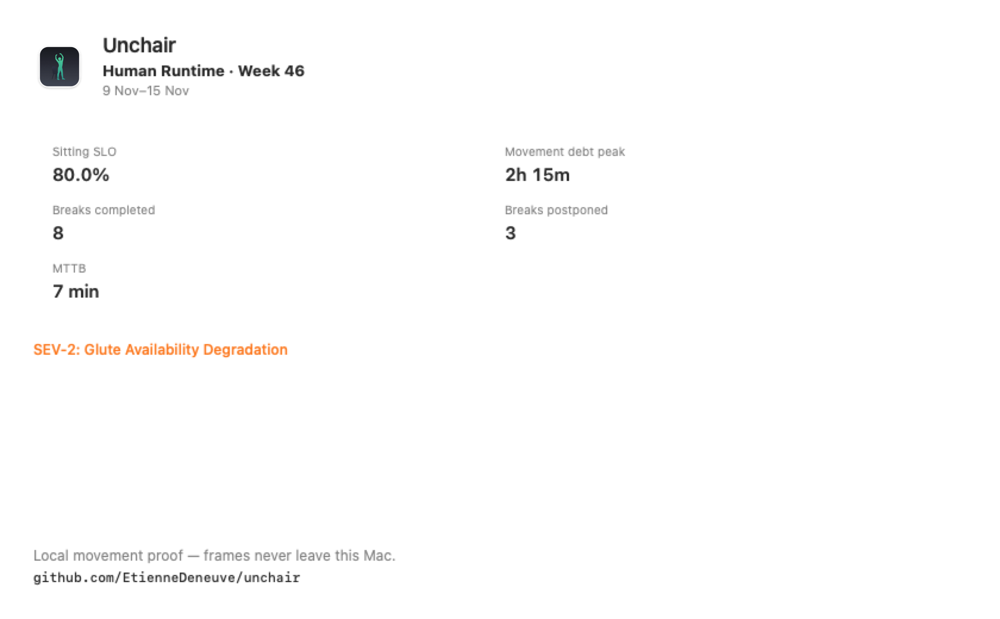

# Human Runtime weekly card

Privacy-safe weekly summary derived **only** from local break history on this Mac.

## Where

Today window → **Human Runtime · Week N** → **Copy Image** / **Save PNG…**

No automatic posting. The user chooses when and where to share.

## Samples

Today window (light / dark) and the branded share PNG live under [`docs/assets/today-ui/`](./assets/today-ui/):

| Today (light) | Share card (Copy / Save) |
| --- | --- |
|  |  |

Also: [`today-dark.png`](./assets/today-ui/today-dark.png), [`today-pathological.png`](./assets/today-ui/today-pathological.png) (50h+ debt fixture).

## Schema (local-only)

| Field | Source | Notes |
| --- | --- | --- |
| Week number | Calendar week of `now` | Monday-start week |
| Sitting SLO | `completed / (completed + skipped)` | Postpones are debt, not scored as failures |
| Movement debt peak | Longest gap between completions in-week | Proxy from history ends — not camera |
| Breaks completed / postponed | History `result` counts | |
| MTTB | Mean `endedAt - startedAt` for completed rows with `startedAt` | Mean Time To Butt-off |
| SEV-2 line | Debt peak ≥ 1h | Deadpan copy only |

## Branding on export

The PNG always includes:

- Unchair app icon + wordmark
- **Human Runtime · Week N** + date range
- Privacy line: local movement proof
- Repo URL: `github.com/EtienneDeneuve/unchair`

## Never included

- camera frames
- body landmarks
- health / HealthKit data
- app or window names
- meeting titles
- hostname / username (by default)
- exact work schedule

## Engineering

- Aggregation: `HumanRuntimeWeeklySummaryCalculator` (pure, fixture-tested)
- Rendering / export: `HumanRuntimeWeeklyCardCanvas` + `HumanRuntimeWeeklyCardExporter`
- Gallery fixtures: `TodayDashboardSnapshotTests` → `docs/assets/today-ui/`
- Network: none

Synthetic examples for docs/marketing are produced from fixtures without a real user history.
